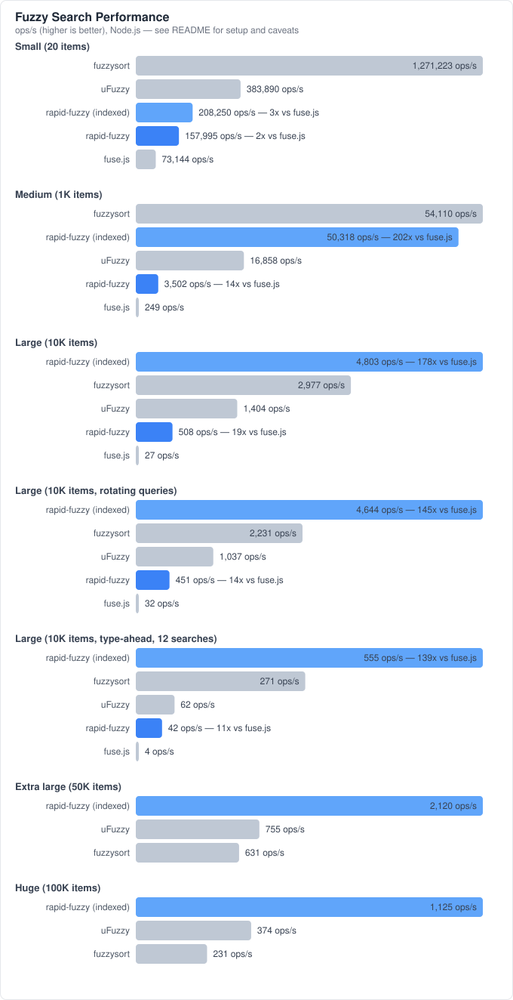
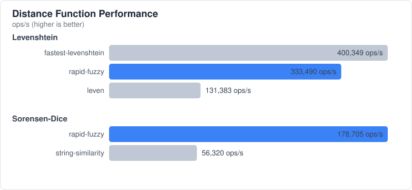

# rapid-fuzzy

[](https://github.com/derodero24/rapid-fuzzy/actions/workflows/ci.yml)
[](https://codspeed.io/derodero24/rapid-fuzzy)
[](https://codecov.io/gh/derodero24/rapid-fuzzy)
[](https://www.npmjs.com/package/rapid-fuzzy)
[](https://www.npmjs.com/package/rapid-fuzzy)
[](https://opensource.org/licenses/MIT)
[](https://nodejs.org/)

Fuzzy search and string similarity for JavaScript and TypeScript, powered by Rust. Native in Node.js, WebAssembly in browsers, Deno, Bun and Cloudflare Workers, with one API.

**[Documentation](https://derodero24.github.io/rapid-fuzzy/)** · **[Playground](https://derodero24.github.io/rapid-fuzzy/playground/)** · **[API reference](https://derodero24.github.io/rapid-fuzzy/api/readme/)** · **[Benchmarks](https://derodero24.github.io/rapid-fuzzy/benchmarks/)**

## Features

- **Fast on large lists**: a persistent `FuzzyIndex` answers a query over 10,000 items in about 0.2 ms, about 180x faster than fuse.js and 1.6x faster than fuzzysort with prepared targets ([benchmarks](#benchmarks)). Large searches use every CPU core in Node.js.
- **Runs everywhere**: a native addon (napi-rs) for Node.js on macOS, Linux and Windows, and a WebAssembly build for browsers, Deno, Bun and Cloudflare Workers, picked by your bundler or runtime on its own.
- **Search that feels like fzf**: the [nucleo](https://github.com/helix-editor/nucleo) matcher from the Helix editor, with smart case, diacritic folding, `^prefix`, `suffix$`, `'exact` and `!exclude` terms in any order, and match positions for highlighting.
- **Objects with weighted keys**: search records across nested keys, and choose how key scores combine (`scoreMode`) and whether terms may match different keys (`matchMode`).
- **String similarity built in**: Levenshtein, Damerau-Levenshtein, Jaro-Winkler, Sørensen-Dice, Hamming, Indel and RapidFuzz-style token ratios, with batch and typed-array variants.
- **Strictly typed, no runtime dependencies**: complete TypeScript declarations, with key paths checked against your item type.

## Install

```bash
npm install rapid-fuzzy
```

Node.js 22 or later. Prebuilt binaries are installed for macOS, Linux (glibc and musl) and Windows on x64 and arm64. See the runtime guides for [Node.js and SSR frameworks](https://derodero24.github.io/rapid-fuzzy/runtimes/node/), [browsers and bundlers](https://derodero24.github.io/rapid-fuzzy/runtimes/browsers/), [Cloudflare Workers](https://derodero24.github.io/rapid-fuzzy/runtimes/cloudflare-workers/) and [Deno and Bun](https://derodero24.github.io/rapid-fuzzy/runtimes/deno-and-bun/).

## Quick start

```ts
import { search, closest, FuzzyIndex } from 'rapid-fuzzy';

search('typscript', ['TypeScript', 'JavaScript', 'Python']);
// → [{ item: 'TypeScript', score: 0.86, index: 0, positions: [] }]

closest('tsc', ['TypeScript', 'JavaScript', 'Python']); // → 'TypeScript'

// Searching the same items many times? Build an index once:
// it is about 10x faster per query on 1,000-10,000 items.
const index = new FuzzyIndex(['TypeScript', 'JavaScript', 'Python']);
index.search('typscript', { maxResults: 5 });
```

Search objects by weighted keys:

```ts
import { searchObjects } from 'rapid-fuzzy';

const users = [
  { name: 'John Smith', city: 'Tokyo' },
  { name: 'Jane Doe', city: 'Osaka' },
];

searchObjects('john tokyo', users, {
  keys: [{ name: 'name', weight: 2 }, 'city'],
  matchMode: 'crossKey', // terms may match different keys
});
```

Compare strings:

```ts
import { levenshtein, jaroWinkler, tokenSortRatio, levenshteinMany } from 'rapid-fuzzy';

levenshtein('kitten', 'sitting'); // → 3
jaroWinkler('martha', 'marhta'); // → 0.961
tokenSortRatio('new york mets', 'mets new york'); // → 1
levenshteinMany('kitten', ['sitting', 'kittens', 'kitchen']); // → [3, 1, 2]
```

Highlight matches:

```ts
import { search, highlight } from 'rapid-fuzzy';

const [match] = search('fzy', ['fuzzy'], { includePositions: true });
highlight(match.item, match.positions, '<b>', '</b>'); // → '<b>f</b>uz<b>zy</b>'
```

## Documentation

The [documentation site](https://derodero24.github.io/rapid-fuzzy/) covers everything in detail:

- **Guides**: [fuzzy search and query syntax](https://derodero24.github.io/rapid-fuzzy/guides/fuzzy-search/), [how matching and scoring work](https://derodero24.github.io/rapid-fuzzy/guides/matching-and-scoring/), [object search](https://derodero24.github.io/rapid-fuzzy/guides/object-search/), [persistent indexes](https://derodero24.github.io/rapid-fuzzy/guides/indexes/), [highlighting](https://derodero24.github.io/rapid-fuzzy/guides/highlighting/), [string similarity](https://derodero24.github.io/rapid-fuzzy/guides/string-similarity/), [choosing an algorithm](https://derodero24.github.io/rapid-fuzzy/guides/choosing-an-algorithm/), [React, Vue and Svelte](https://derodero24.github.io/rapid-fuzzy/guides/ui-frameworks/), [Unicode and non-Latin scripts](https://derodero24.github.io/rapid-fuzzy/guides/unicode/), [performance and untrusted input](https://derodero24.github.io/rapid-fuzzy/guides/performance/) and [errors and edge cases](https://derodero24.github.io/rapid-fuzzy/guides/errors/).
- **[API reference](https://derodero24.github.io/rapid-fuzzy/api/readme/)**, generated from the type declarations.
- **[Troubleshooting](https://derodero24.github.io/rapid-fuzzy/runtimes/troubleshooting/)** for native binding, WebAssembly and SSR errors.
- **[llms.txt](https://derodero24.github.io/rapid-fuzzy/llms.txt)** for AI assistants.

## Benchmarks

<!-- bench:env:start -->
Measured on 2026-10-04 with Node.js v22.22.0 on linux x64 (Intel(R) Xeon(R) Processor @ 2.10GHz, 4 logical CPUs, a shared cloud VM), using the release build of the native addon and [Vitest bench](https://vitest.dev/guide/benchmarking). Numbers vary by up to about ±10% between runs; treat them as relative, not absolute.
<!-- bench:env:end -->

Ops/s, higher is better. Each library returns its top 5 or 10 results; the libraries match differently, so these numbers compare the cost of a search, not identical work. See [Benchmarks](https://derodero24.github.io/rapid-fuzzy/benchmarks/) for the method, the closest-match and ratio tables, and how to re-run them.



<!-- bench:search:start -->
| Dataset | rapid-fuzzy | rapid-fuzzy (indexed) | fuse.js | fuzzysort | uFuzzy |
|---|---:|---:|---:|---:|---:|
| Small (20 items) | 157,995 ops/s | 208,250 ops/s | 73,144 ops/s | **1,271,223 ops/s** | 383,890 ops/s |
| Medium (1K items) | 3,502 ops/s | 50,318 ops/s | 249 ops/s | **54,110 ops/s** | 16,858 ops/s |
| Large (10K items) | 508 ops/s | **4,803 ops/s** | 27 ops/s | 2,977 ops/s | 1,404 ops/s |
| Large (10K items, rotating queries) | 451 ops/s | **4,644 ops/s** | 32 ops/s | 2,231 ops/s | 1,037 ops/s |
| Large (10K items, type-ahead, 12 searches) | 42 ops/s | **555 ops/s** | 4 ops/s | 271 ops/s | 62 ops/s |
| Extra large (50K items) | — | **2,120 ops/s** | — | 631 ops/s | 755 ops/s |
| Huge (100K items) | — | **1,125 ops/s** | — | 231 ops/s | 374 ops/s |
<!-- bench:search:end -->



<!-- bench:distance:start -->
| Function | rapid-fuzzy | fastest-levenshtein | leven | string-similarity |
|---|---:|---:|---:|---:|
| Levenshtein | 333,490 ops/s | **400,349 ops/s** | 131,383 ops/s | — |
| Normalized Levenshtein | 325,462 ops/s | — | — | — |
| Sorensen-Dice | **178,705 ops/s** | — | — | 56,320 ops/s |
| Jaro-Winkler | 299,960 ops/s | — | — | — |
| Damerau-Levenshtein | 87,724 ops/s | — | — | — |
| Hamming | 477,800 ops/s | — | — | — |
<!-- bench:distance:end -->

fuzzysort and uFuzzy are faster on lists of a few dozen items, and fastest-levenshtein on single Levenshtein calls, because crossing into Rust costs more than such small jobs.

## Why rapid-fuzzy?

rapid-fuzzy combines fzf-style fuzzy search with RapidFuzz-style string metrics in one Rust core. It is the fastest choice for lists of ten thousand items or more (and on par with fuzzysort at a thousand), for search across weighted object keys, and for code that needs both search and similarity scores. Choose something else for the smallest bundle (the WebAssembly build is about 195 KB gzipped), for typo tolerance in search (fuse.js), or for full-text search over documents (MiniSearch, Orama). The [comparison](https://derodero24.github.io/rapid-fuzzy/comparison/) covers fuse.js, fuzzysort, uFuzzy, match-sorter and others in detail.

Coming from another library? See the migration guides for [fuse.js](https://derodero24.github.io/rapid-fuzzy/migration/from-fuse-js/), [fuzzysort](https://derodero24.github.io/rapid-fuzzy/migration/from-fuzzysort/), [uFuzzy](https://derodero24.github.io/rapid-fuzzy/migration/from-ufuzzy/), [fuzzball](https://derodero24.github.io/rapid-fuzzy/migration/from-fuzzball/), [leven and fastest-levenshtein](https://derodero24.github.io/rapid-fuzzy/migration/from-leven/), [string-similarity](https://derodero24.github.io/rapid-fuzzy/migration/from-string-similarity/), [FlexSearch](https://derodero24.github.io/rapid-fuzzy/migration/from-flexsearch/) and [MiniSearch](https://derodero24.github.io/rapid-fuzzy/migration/from-minisearch/).

## Contributing

See [CONTRIBUTING.md](CONTRIBUTING.md). The documentation site lives in [`site/`](site/).

## License

MIT
